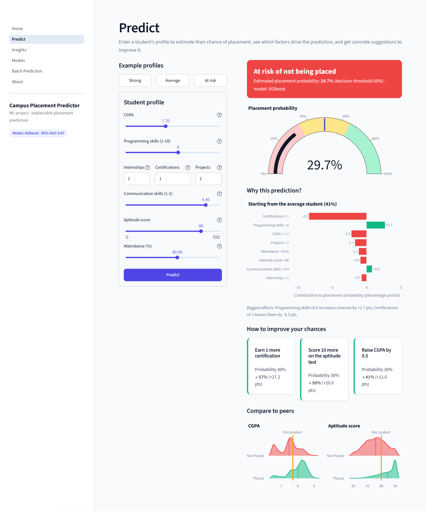
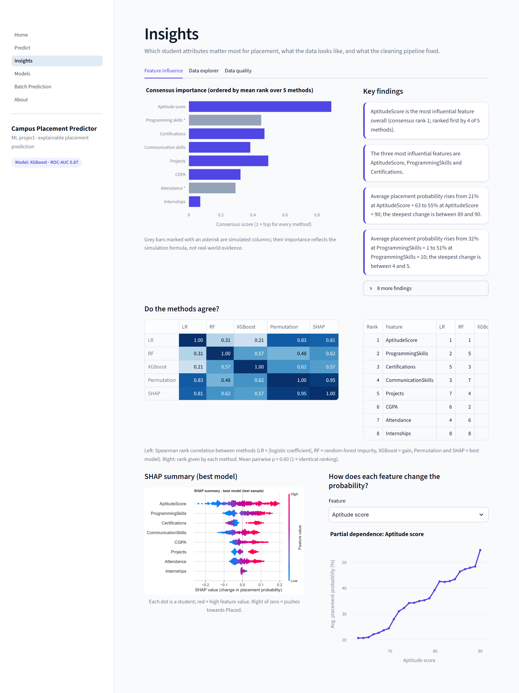
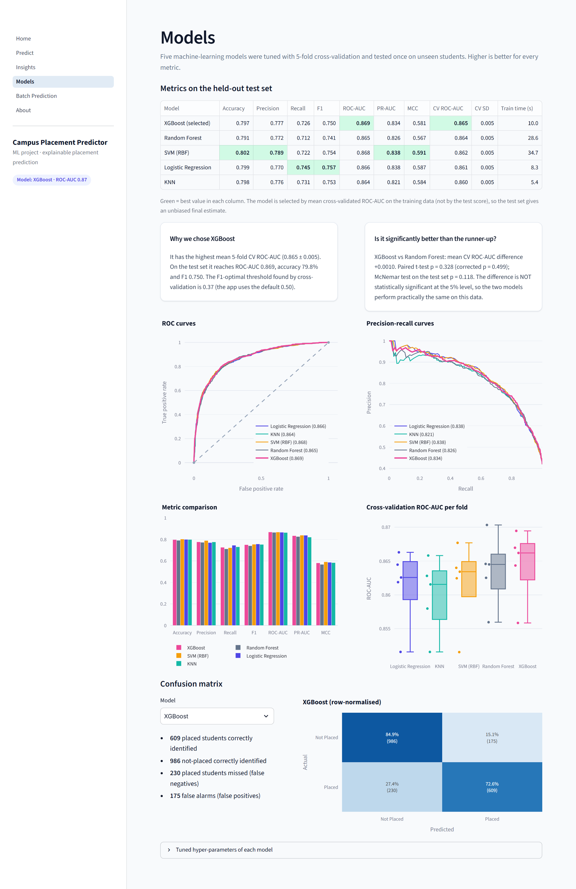

# Campus Placement Predictor

Predicts whether an engineering student will be **Placed** or **Not Placed** from eight attributes (CGPA,
programming skills, internships, certifications, communication skills, aptitude score, projects and attendance),
and identifies which attributes influence placement most.

The project includes:
- a reproducible ML pipeline: data download, cleaning, five tuned models and multi-method explainability;
- a Streamlit web app for single-student prediction (with explanation and what-if advice) and batch scoring;
- an IEEE two-column LaTeX report whose numbers are generated from the pipeline outputs.



## Quick start

Requires Python 3.10–3.12. Everything runs on a CPU.

```bash
python -m venv .venv
.venv\Scripts\activate            # Windows  (Linux/macOS: source .venv/bin/activate)
pip install -r requirements.txt
python run_all.py                 # rebuilds data, models, figures, metrics and report tables (~2 min)
streamlit run app/Home.py         # opens the web app at http://localhost:8501
```

`python run_all.py` downloads the dataset automatically from the Hugging Face mirror. If the download fails,
save `placementdata.csv` from Kaggle ("Placement Prediction Dataset") as `data/raw/placementdata.csv` and run it
again. The trained models are committed, so the app also works straight after cloning without re-running the
pipeline.

**Report:** upload `report_overleaf.zip` to [Overleaf](https://www.overleaf.com) (New Project → Upload Project)
and compile `main.tex` with pdfLaTeX and BibTeX.

## What the pipeline does

| Step | Module | Output |
|---|---|---|
| Download data, add 2 simulated columns, inject data-quality issues | `src/get_data.py` | `data/raw/`, `data/interim/` |
| Exploratory figures | `src/eda.py` | `reports/figures/*.png`, `reports/data_summary.csv` |
| Cleaning (labels, duplicates, ranges, IQR capping, stratified split) | `src/preprocess.py` | `data/processed/placement_clean.csv`, `reports/preprocessing_log.json` |
| Feature engineering, feature selection, VIF | `src/features.py` | `reports/feature_selection.csv`, `reports/vif.csv` |
| Train and tune LR, KNN, SVM, Random Forest, XGBoost (5-fold CV) | `src/train.py` | `models/`, `reports/model_comparison.csv`, `reports/metrics.json` |
| Feature influence (LR, RF, XGBoost, permutation, SHAP, PDP) | `src/explain.py` | `reports/feature_importance.csv`, insights in `metrics.json` |
| LaTeX tables and number macros, Overleaf zip | `src/make_report_tables.py` | `report/tables/`, `report_overleaf.zip` |

Prediction, explanation and what-if logic used by the app live in `src/predict.py`. All random processes use
`RANDOM_STATE = 42` from `src/config.py`.

## Web app pages

| Page | Purpose |
|---|---|
| Home | Dataset size, placement rate, best model, top influential features |
| Predict | Enter a profile → probability gauge, SHAP explanation, top improvement actions, comparison with peers |
| Insights | Consensus feature importance, method agreement, partial dependence, data explorer, data-quality report |
| Models | Metrics table, ROC/PR curves, CV scores, confusion matrices, significance test, hyper-parameters |
| Batch Prediction | Upload a CSV (template provided), validate rows, score all students, download results |
| About | Problem statement, team, data source and limitations |

| Insights | Models |
|---|---|
|  |  |

## Project structure

```
├── run_all.py                  # one command rebuilds everything
├── requirements.txt
├── src/                        # pipeline modules (config, get_data, preprocess, features, eda,
│                               #   train, explain, predict, make_report_tables, utils)
├── app/                        # Streamlit app: Home.py, pages/, components.py
├── .streamlit/config.toml      # app theme
├── data/                       # raw, interim (augmented + injected issues), processed
├── models/                     # best_model.joblib, all_models/, model_meta.json
├── reports/                    # figures/, screenshots/, metrics.json and CSV outputs
├── notebooks/walkthrough.ipynb # executed walkthrough for the viva
├── report/                     # main.tex, references.bib, IEEEtran.cls/.bst, figures/, tables/
├── DECISIONS.md                # design decisions and their reasons
└── REPORT_TODO.md              # what the team still has to fill in / verify
```

## Important notes on the data

- `ProgrammingSkills` and `Attendance` do not exist in any public dataset. They are **simulated** with documented,
  seeded formulas (see `src/config.py`), so their measured influence reflects those assumptions.
- Data-quality problems (missing values, duplicates, invalid entries, inconsistent labels) were **deliberately
  injected** so that the cleaning pipeline could be demonstrated and verified. Every injected and fixed count is
  logged in `reports/preprocessing_log.json`.
- The base dataset is public and may itself be partly synthetic. Results should be validated on real
  institutional data before any operational use.

## Results

Model metrics, the selected model, the statistical comparison and the generated insights are in
`reports/metrics.json` and `reports/model_comparison.csv`. `python run_all.py` also prints a summary table at the end.
